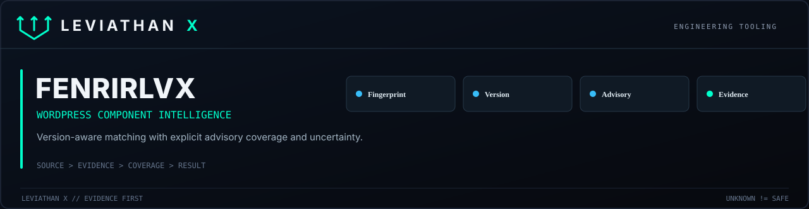
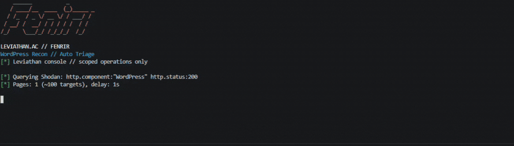

<p align="center">
  
</p>

# FenrirLVX

**WordPress component evidence and local vulnerability-advisory correlation.**

FenrirLVX is a Go command-line tool from **Leviathan X**. It identifies WordPress components on an authorized site, compares detected versions against a bundled advisory snapshot, and reports coverage gaps rather than treating missing advisory data as proof of safety.

[CI](https://github.com/cyeezy08/FenrirLVX/actions/workflows/ci.yml) | [Releases](https://github.com/cyeezy08/FenrirLVX/releases) | [Security policy](SECURITY.md) | [License](LICENSE)

> **Scope:** Only run network-facing checks against systems you own or are explicitly authorized to assess. Passive provider observations do not establish permission to probe the resulting hosts.

## What it does

| Stage | Function | Evidence or limitation |
| --- | --- | --- |
| Fingerprint | Identify WordPress signals in retrieved web responses | HTTP observations and component signals, not proof of a vulnerable installation |
| Enumerate | Extract plugin and theme indicators from an authorized target | Unknown and unreadable versions remain unknown |
| Correlate | Compare plugin versions with `vuln_db.json` advisory ranges | Matches are advisory candidates, not exploit confirmation |
| Report | Display affected components, CVEs, CVSS and confidence indicators | Report how many detected plugins had no matching advisory coverage |
| Enrich | Optional Shodan context for a declared, authorized target | Depends on separate provider access; not needed for local advisory matching |

The range matcher uses dotted numeric component versions. It deliberately rejects malformed and non-numeric versions rather than comparing them as zero. Open-ended advisory ranges are flagged; they require human interpretation.

## Real terminal view

<p align="center">
  
</p>

This is an existing repository recording, not a generated demonstration or a statement that current targets are vulnerable.

## Quickstart

Requires **Go 1.27 or newer**, matching `go.mod`.

```bash
git clone https://github.com/cyeezy08/FenrirLVX.git
cd FenrirLVX
go build -o fenrir .
./fenrir version
./fenrir scan -t https://staging.example.org
```

`vuln_db.json` must be accessible from the working directory. The source repository includes the snapshot. The tool does not download an updated CVE catalog automatically.

On Windows, build with `go build -o fenrir.exe .` and use `.\fenrir.exe`. For release binaries, download the matching platform archive from [Releases](https://github.com/cyeezy08/FenrirLVX/releases), verify the published `SHA256SUMS`, and retain the bundled advisory file alongside the executable.

### Commands

| Command | Purpose |
| --- | --- |
| `fenrir scan -t URL` | Direct WordPress inspection and local advisory correlation |
| `fenrir wordpress -t DOMAIN` | Domain inspection with optional Shodan enrichment and XML-RPC response check |
| `fenrir mass` | Legacy multi-target provider query workflow. Use only for an explicitly approved asset inventory |
| `fenrir version` | Build identification |
| `fenrir --help` | Supported flags and syntax |

Shodan enrichment is optional and requires the `SHODAN_API_KEY` value passed through the current CLI's `-k` flag. Command-line secrets can be visible in process listings or shell history. Use a trusted environment and never commit keys to GitHub.

The network client verifies TLS certificates by default, limits response bodies, and does not follow redirects to different origins. Failed requests are not interpreted as clean vulnerability results.

## Understanding results

A finding should be read as **observed component + detected version + advisory range**, not as proof of exploitability. Correlation is bounded by the age, scope and completeness of the locally supplied data.

For example, if three of seven observed plugins appear in the advisory snapshot, the report discloses **3/7 covered, 4 without advisory coverage**. It does not claim that all seven are safe.

```text
Coverage: detected=7, matched=3, without-advisories=4
Result: no matched advisory does not mean no vulnerability
```

The block above illustrates how to interpret coverage; it is not a scan of a real target. Review `pkg/engine/vuln.go`, `pkg/engine/semver.go`, and the tests for the precise matching rules.

## Advisory data

The included `vuln_db.json` is a **snapshot**. It is not guaranteed to be current, complete or independently validated. The maintenance converter in `tools/convertor.go` supports rebuilding this file from a lawfully obtained Wordfence export; data-access rights and feed terms remain the operator's responsibility.

After updating a feed, review provenance and mapping changes, then run the test suite before releasing a new binary. Missing data must remain visible in reports.

## Development and release quality

```bash
go mod download
go test ./... -count=1
go vet ./...
go build ./...
```

The repository includes regression coverage for advisory bounds, unreadable versions, coverage disclosure and evidence classification. GitHub Actions is the verification source for the current branch; a successful historical CI run does not validate unmerged changes.

The release workflow builds platform archives and records checksums. Inspect its workflow and published artifacts rather than assuming a release exists for every commit.

## Leviathan X tooling

FenrirLVX is one focused tool in the Leviathan X suite:

- **[HostageLVX](https://github.com/cyeezy08/HostageLVX):** dangling DNS verification and careful provider fingerprint classification.
- **[surfacediff](https://github.com/cyeezy08/surfacediff):** reproducible asset snapshots, field-level changes and historical evidence.
- **FenrirLVX:** WordPress component observation, advisory ranges and coverage accounting.

The CLI tools remain independently usable. A unified intelligence workbench is a separate workstream, not a feature claimed to be shipped in this repository.

**Security reporting:** See [SECURITY.md](SECURITY.md). **License:** MIT.
